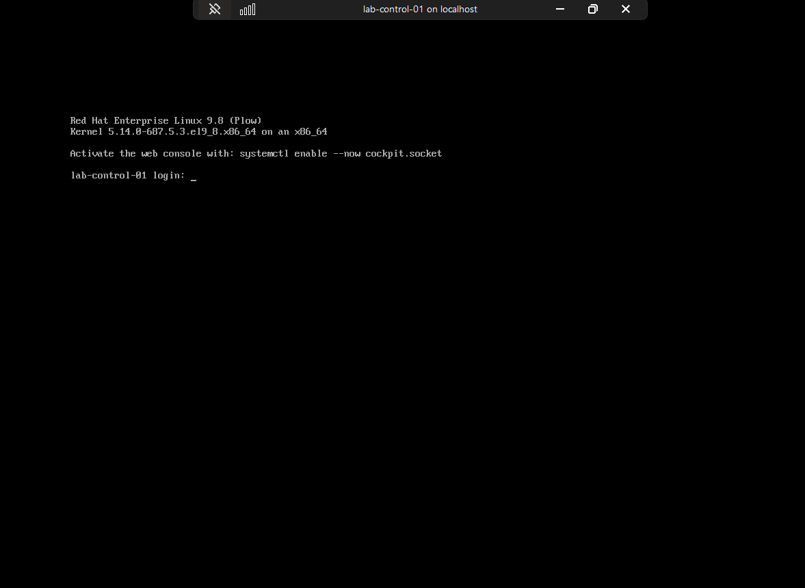
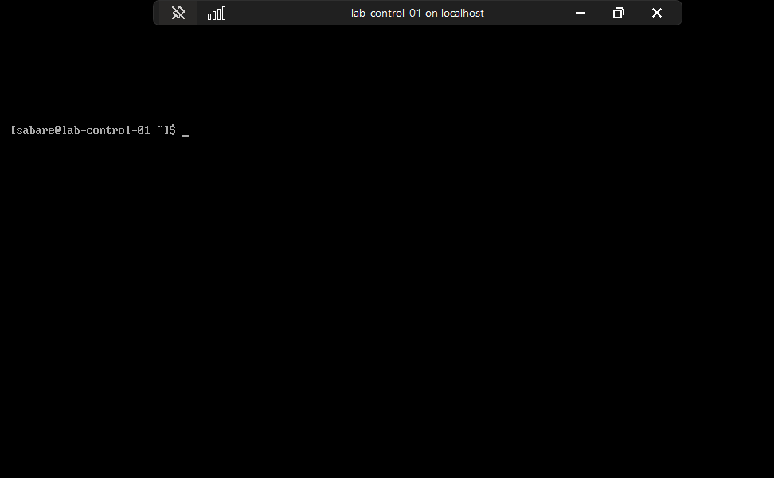
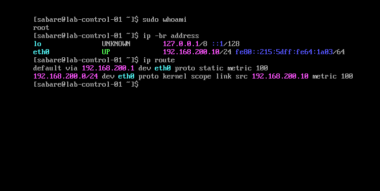
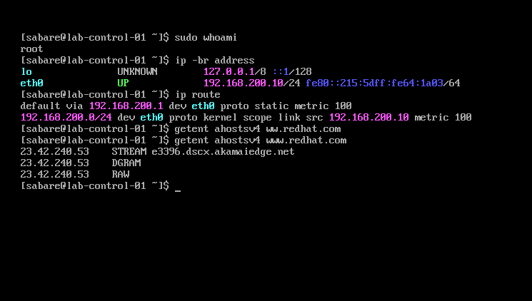
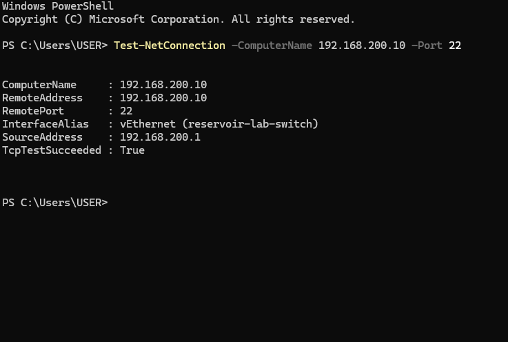
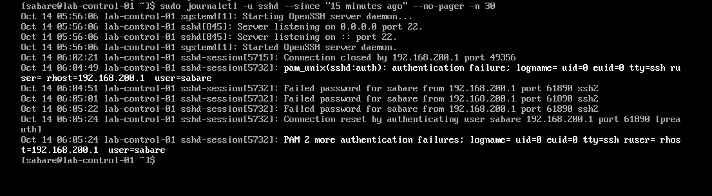

# First boot, networking, SSH and package access

Evidence captured during the guided build on 2026-10-14. Commands labelled
RHEL run inside the VM, either through its console or an established SSH
session. Windows commands run in PowerShell. Check the prompt before typing.

## 1. Confirm the installed system boots

After installation, select **Reboot System**. The observed result was the
RHEL 9.8 login prompt for `lab-control-01`, rather than the installation menu.



*Evidence: the installed system reaches its login prompt. The on-screen
Cockpit activation suggestion was not executed as part of this milestone.*

Log in locally as `sabare` using the privately chosen password. Linux terminal
password prompts do not echo characters or asterisks.



*Evidence: named-user console login works. This screen predates the SSH test
and should not be used as proof of remote authentication.*

## 2. Verify administrator access and network settings

Run in **RHEL**, one command at a time:

```bash
sudo whoami
ip -br address
ip route
```

| Command | Purpose | Observed result |
| --- | --- | --- |
| `sudo whoami` | Test ability to run a command as administrator | `root` |
| `ip -br address` | Brief interface and address listing | `eth0` UP, `192.168.200.10/24` |
| `ip route` | Inspect traffic-routing rules | Default via `192.168.200.1`, device `eth0` |



*Evidence: address and gateway settings survived the installation reboot.
The local subnet route lets nodes communicate directly; the default route
handles destinations outside that subnet. This does not by itself prove
internet access. The visible IPv6 address is a local lab link-local address.*

## 3. Test name resolution and HTTPS separately

Run in **RHEL**:

```bash
getent ahostsv4 www.redhat.com
curl -I --connect-timeout 10 --max-time 30 https://www.redhat.com
```

`getent` uses the configured name-resolution system. The observed IPv4
response was `23.42.240.53`; it may differ on another run. Repeated STREAM,
DGRAM and RAW entries are normal socket-type listings.



*Evidence: the corrected hostname lookup returns records. The preceding
mistyped lookup produced no result; the successful command uses www.redhat.com.*

`curl -I` retrieves headers rather than the page body, with bounded connection
and total timeouts. It returned **HTTP/2 301**, redirecting to
`https://www.redhat.com/en`. This demonstrates an HTTPS response from that
endpoint with normal certificate checking, not access to every internet site.

The HTTP-header screenshot is intentionally omitted because it includes
Set-Cookie values. The result is transcribed above without those values.

## 4. Check SSH on the guest and from Windows

Run in **RHEL**:

```bash
systemctl is-active sshd
```

It returned `active`. `sshd` is the server accepting encrypted terminal
connections; this command only checks its current service state.

Run in **Windows PowerShell**:

```powershell
Test-NetConnection -ComputerName 192.168.200.10 -Port 22
```



*Evidence: Windows reached port 22 through reservoir-lab-switch, from
192.168.200.1 to 192.168.200.10. TCP success is separate from SSH authentication.*

## 5. Verify the host identity and log in

In the **trusted Hyper-V RHEL console**, obtain the server public-key fingerprint:

```bash
sudo ssh-keygen -lf /etc/ssh/ssh_host_ed25519_key.pub
```

This reads an existing public key; it does not create a new key. The first
attempt contained a command-name typo; rerunning `ssh-keygen` correctly worked.

From **Windows PowerShell**:

```powershell
ssh sabare@192.168.200.10
```

Compare the ED25519 SHA-256 fingerprint with the console output before
accepting the first connection. Accept only a match. Windows then stores the
host key in known_hosts. Enter the local `sabare` password when prompted;
this is not the Red Hat website account password.

### Authentication troubleshooting

The first login failed after password attempts, although TCP connectivity
worked. Inspect the server log from the already-open **RHEL console**:

```bash
sudo journalctl -u sshd --since "15 minutes ago" --no-pager -n 30
```

This selects recent SSH service logs without entering a pager. The output
showed `pam_unix` authentication failures and failed passwords for `sabare`;
it did not establish a network failure or an explicit account lock.



*Troubleshooting evidence: the guest received the Windows connection but
rejected password authentication. These are local lab addresses and usernames;
no password is printed. Later login success was reported by the user.*

The user changed their own password in the console with:

```bash
passwd
```

This prompts privately for the current password and the new password twice.
It is a troubleshooting action, not a command to run on every login. No
password is recorded here. After retrying SSH, the user confirmed login
worked with the new password. The exact cause of the original mismatch
(for example typing or keyboard layout) was not proven.

## 6. Register with Red Hat

In the **RHEL SSH session**:

```bash
sudo subscription-manager identity
```

The result was that the system was not yet registered. The user then ran:

```bash
sudo subscription-manager register
```

Enter the local `sabare` password at a sudo prompt, then the Red Hat login ID
and account password at the registration prompts. Do not place credentials
in command arguments, Git or screenshots. Registration was reported successful;
system UUID and account/organisation details are not included in this repo.

## 7. Verify repository configuration, then metadata access

In **RHEL**:

```bash
sudo dnf repolist --enabled
```

The user confirmed BaseOS and AppStream are enabled. These supply core OS
packages and additional application/tool packages. An enabled listing alone
does not prove repository metadata can be downloaded.

The next command was issued as the metadata-access test:

```bash
sudo dnf makecache --refresh
```

`makecache` builds the local repository-metadata cache; `--refresh` expires
cached metadata before the operation so DNF checks the repositories again.
It does not install or upgrade packages. The user subsequently supplied
"Metadata cache created", confirming success.

## Continued preparation

Storage, updates, fixed VM memory, persistent swap disablement, time
synchronisation, SELinux/firewall inspection, CRI-O and Kubernetes package
installation are documented in [node preparation](05-kubernetes-node-preparation.md).
Effective SSH policy and cluster deployment remain pending.
