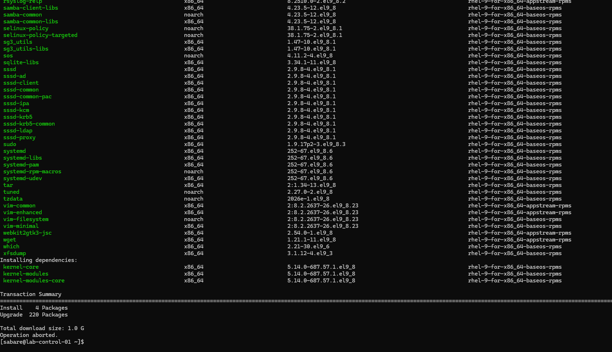
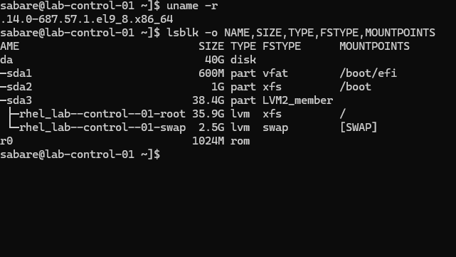
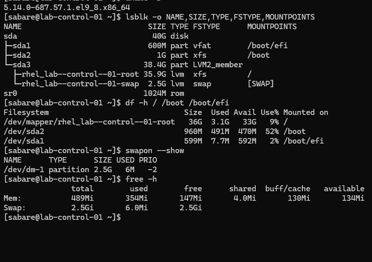
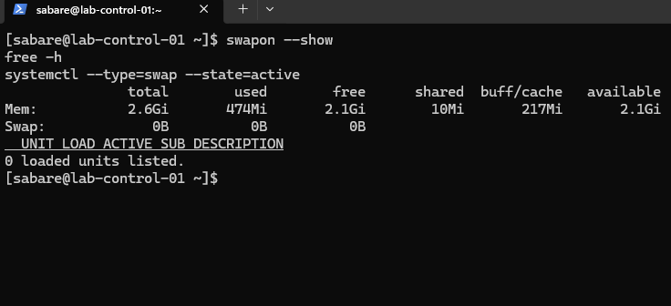
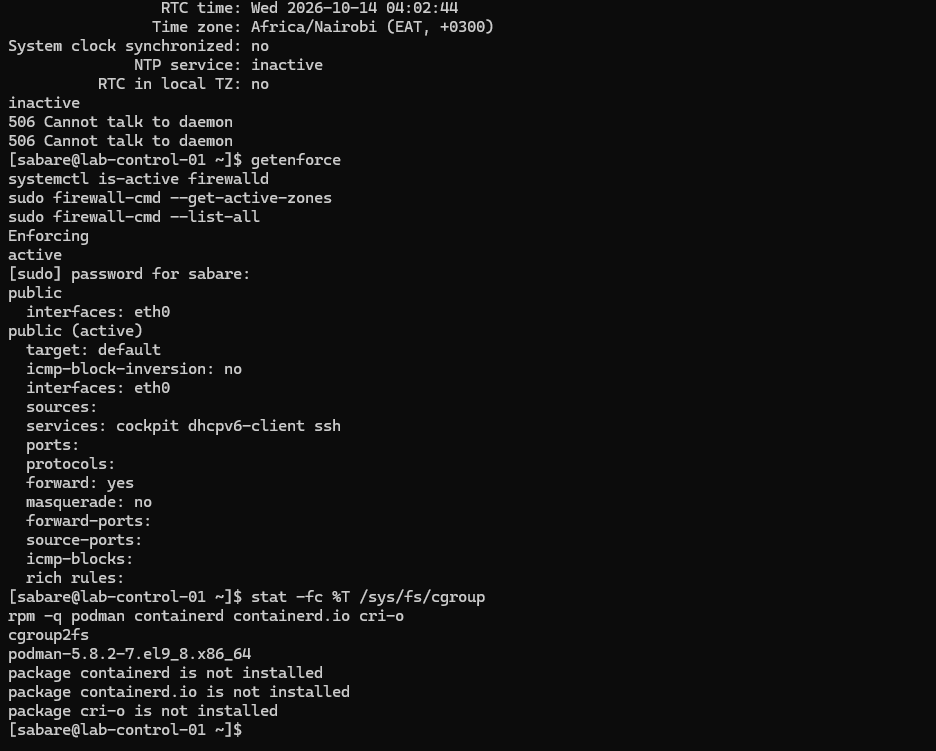
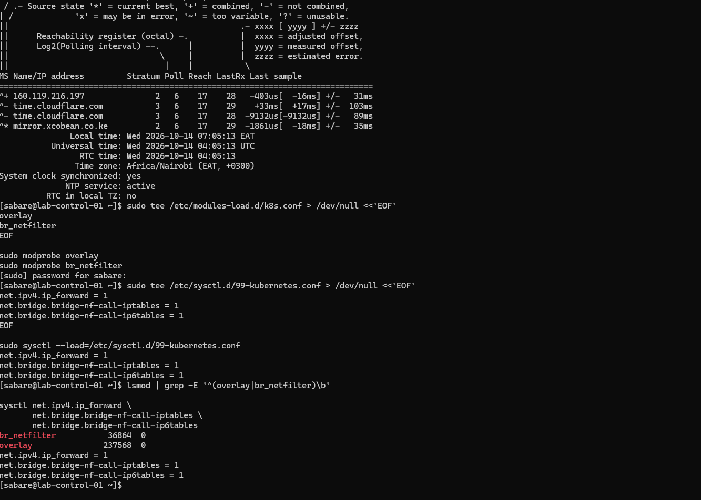
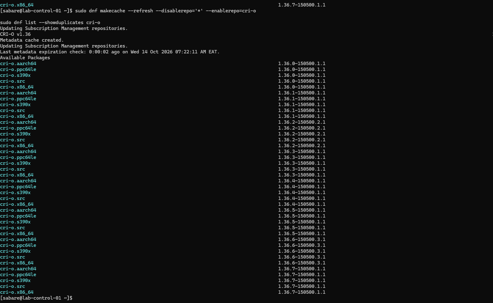
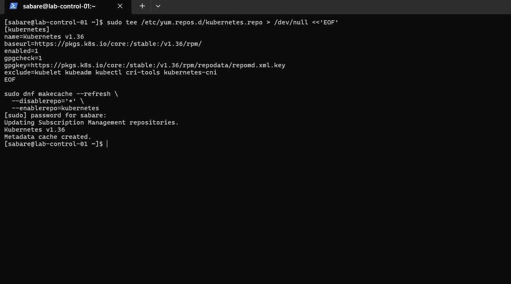
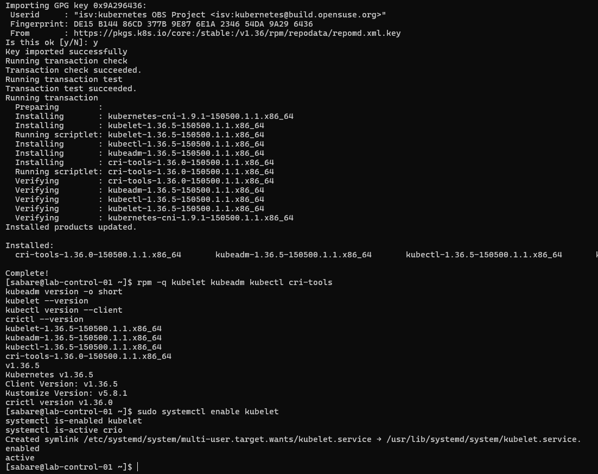

# Preparing the first RHEL Kubernetes node

Recorded 2026-10-14 (Africa/Nairobi). These commands document the guided build;
do not rerun configuration writes blindly. Unless labelled Windows, commands
run in the RHEL SSH session as `sabare`, with `sudo` where required.

## Current outcome

This chapter records preparation through package installation. Subsequent runtime checks, successful cluster initialisation and operator readiness are documented in [control-plane and Calico preparation](07-control-plane-and-calico.md).

## 1. Update RHEL and inspect storage

```bash
sudo dnf makecache --refresh
sudo dnf upgrade --refresh --assumeno
sudo dnf upgrade --refresh
sudo reboot
```

Metadata retrieval succeeded. The preview proposed four installations and 220
upgrades, approximately 1 GB to download. `--assumeno` intentionally ends with
`Operation aborted`; it is a preview, not a failed installation.
The actual upgrade subsequently reported `Complete!` in shared terminal output.



Reconnect from Windows using `ssh sabare@192.168.200.10`, then inspect:

```bash
uname -r
lsblk -o NAME,SIZE,TYPE,FSTYPE,MOUNTPOINTS
df -h / /boot /boot/efi
swapon --show
free -h
```

The running kernel became `5.14.0-687.57.1.el9_8.x86_64`. The 40 GiB disk has
an EFI partition, an XFS boot partition and LVM logical volumes for root and
swap. Root had approximately 33 GiB available. LVM separates logical storage
allocation from physical partitions; XFS is the filesystem used for root.



## 2. Correct the VM memory allocation

The guest initially reported only 489 MiB RAM. Hyper-V inspection showed Dynamic
Memory enabled, a 512 MiB minimum and 3072 MiB startup allocation. Samples were
taken at different times; their memory numbers need not match exactly.



Shut down gracefully from RHEL:

```bash
sudo shutdown -h now
```

In **Windows PowerShell**, confirm the VM is Off before changing memory:

```powershell
Get-VM -Name "lab-control-01" | Select-Object Name, State
Set-VMMemory -VMName "lab-control-01" -DynamicMemoryEnabled $false -StartupBytes 3GB
Get-VMMemory -VMName "lab-control-01" | Select-Object DynamicMemoryEnabled, @{Name='StartupMiB';Expression={$_.Startup / 1MB}}
Start-VM -Name "lab-control-01"
```

The user confirmed False and 3072. After boot, RHEL showed about 2.6 GiB usable
RAM. Fixed allocation provides a predictable baseline for this node.

## 3. Disable swap persistently

This lab uses a no-swap Kubernetes baseline. Kubernetes can support explicitly
configured swap use, but that is outside this initial setup. Disabling swap
does not create more RAM: workloads still need appropriate memory limits.

```bash
sudo swapoff -a
swapon --show
cat /etc/fstab
sudo cp -a /etc/fstab "/etc/fstab.before-disable-swap.$(date +%Y%m%d-%H%M%S)"
sudo sed -i '\|^/dev/mapper/rhel_lab--control--01-swap[[:space:]]|s|^|# Disabled for Kubernetes: |' /etc/fstab
sudo findmnt --verify --verbose
sudo systemctl daemon-reload
sudo reboot
```

The edit targets the exact swap line observed on this VM. The backup preserves
the original mount configuration. `findmnt` validates it; daemon-reload refreshes
systemd's generated units. The swap logical volume was not deleted.

After reconnecting:

```bash
swapon --show
free -h
systemctl --type=swap --state=active
```

Verified after reboot: no active swap devices, Swap 0B, zero active swap units.



## 4. Inspect security, cgroups and time

```bash
timedatectl
systemctl is-active chronyd
chronyc tracking
chronyc sources -v
getenforce
systemctl is-active firewalld
sudo firewall-cmd --get-active-zones
sudo firewall-cmd --list-all
stat -fc %T /sys/fs/cgroup
rpm -q podman containerd containerd.io cri-o
```

Initial results: chronyd inactive, SELinux Enforcing, firewalld active on eth0
in the public zone, and cgroup2fs. Podman was installed; CRI-O was not yet installed.
The chronyc error `506 Cannot talk to daemon` occurred because chronyd was stopped.



Enable time synchronisation and inspect it after allowing time to contact servers:

```bash
sudo systemctl enable --now chronyd
systemctl is-enabled chronyd
systemctl is-active chronyd
chronyc tracking
chronyc sources -v
timedatectl
```

Verified: enabled, active, Leap status Normal, a selected `^*` time source and
System clock synchronized: yes. Correct time helps certificate validation and
correlating logs across nodes. SELinux and firewalld were not disabled at this stage. Firewalld was later disabled during Calico preparation.

## 5. Prepare kernel modules and packet forwarding

```bash
sudo tee /etc/modules-load.d/k8s.conf > /dev/null <<'EOF'
overlay
br_netfilter
EOF
sudo modprobe overlay
sudo modprobe br_netfilter

sudo tee /etc/sysctl.d/99-kubernetes.conf > /dev/null <<'EOF'
net.ipv4.ip_forward = 1
net.bridge.bridge-nf-call-iptables = 1
net.bridge.bridge-nf-call-ip6tables = 1
EOF
sudo sysctl --load=/etc/sysctl.d/99-kubernetes.conf

lsmod | grep -E '^(overlay|br_netfilter)\b'
sysctl net.ipv4.ip_forward net.bridge.bridge-nf-call-iptables net.bridge.bridge-nf-call-ip6tables
```

Overlay supports layered container filesystems. Bridge netfilter allows filtering
of bridged traffic; requirements depend on the eventual network plugin. IPv4
forwarding permits routing between interfaces. The files persist the settings;
modprobe and sysctl apply them immediately. Both modules and three values of 1
were observed. Persistence after a further reboot has not yet been demonstrated.



## 6. Install CRI-O

Podman builds and tests images directly. CRI-O serves Kubernetes' Container Runtime
Interface (CRI), managing containers requested by the kubelet. They have different
roles and can coexist. This lab selected the 1.36 CRI-O and Kubernetes series.

```bash
sudo tee /etc/yum.repos.d/cri-o.repo > /dev/null <<'EOF'
[cri-o]
name=CRI-O v1.36
baseurl=https://download.opensuse.org/repositories/isv:/cri-o:/stable:/v1.36/rpm/
enabled=1
gpgcheck=1
gpgkey=https://download.opensuse.org/repositories/isv:/cri-o:/stable:/v1.36/rpm/repodata/repomd.xml.key
EOF
sudo dnf makecache --refresh --disablerepo='*' --enablerepo=cri-o
sudo dnf list --showduplicates cri-o
sudo dnf install cri-o container-selinux --assumeno
sudo dnf install cri-o container-selinux
rpm -q cri-o container-selinux podman
crio --version
sudo systemctl enable --now crio
systemctl is-enabled crio
systemctl is-active crio
```



The preview selected cri-o 1.36.7-150500.1.1, with container-selinux already
installed and no removals. Initially only the preview was run, so `crio: command
not found` and missing service errors followed. Running the actual installation
resolved this. The user reported CRI-O installed, enabled and active; the later
Kubernetes screenshot independently shows its active service state. A captured
post-install `crio --version` result is still absent.

### Red Hat subscription warning

DNF displayed a registered-but-not-receiving-updates warning. It was investigated
separately from CRI-O's community repository:

```bash
sudo subscription-manager identity
sudo subscription-manager status
sudo subscription-manager refresh
sudo subscription-manager repos --list-enabled
sudo dnf makecache --refresh --disablerepo='*' --enablerepo=rhel-9-for-x86_64-baseos-rpms --enablerepo=rhel-9-for-x86_64-appstream-rpms
sudo dnf check-update --disablerepo='*' --enablerepo=rhel-9-for-x86_64-baseos-rpms --enablerepo=rhel-9-for-x86_64-appstream-rpms
printf 'DNF exit code: %s\n' "$?"
```

The user reported successful metadata refresh and update checking. That confirms
repository access at the time of testing, not that the warning disappeared.
Under Simple Content Access, Disabled status alone is not proof of lost access;
the actual status output was not supplied. No subscription UUIDs are published.
DNF check-update returns 0 for no updates, 100 for updates available, 1 for error.

## 7. Install Kubernetes packages

```bash
sudo tee /etc/yum.repos.d/kubernetes.repo > /dev/null <<'EOF'
[kubernetes]
name=Kubernetes v1.36
baseurl=https://pkgs.k8s.io/core:/stable:/v1.36/rpm/
enabled=1
gpgcheck=1
gpgkey=https://pkgs.k8s.io/core:/stable:/v1.36/rpm/repodata/repomd.xml.key
exclude=kubelet kubeadm kubectl cri-tools kubernetes-cni
EOF
sudo dnf makecache --refresh --disablerepo='*' --enablerepo=kubernetes
sudo dnf install kubelet kubeadm kubectl cri-tools --disableexcludes=kubernetes
```



The exclusion prevents ordinary DNF updates from unexpectedly upgrading these
packages. The explicit override permits this planned installation. Package
signature verification stays enabled. This command selects the available patch
from the 1.36 stream; it is not an exact historical patch pin for future rebuilds.

```bash
rpm -q kubelet kubeadm kubectl cri-tools
kubeadm version -o short
kubelet --version
kubectl version --client
crictl --version
sudo systemctl enable kubelet
systemctl is-enabled kubelet
systemctl is-active crio
```

| Component | Observed version/state | Purpose |
| --- | --- | --- |
| kubeadm | 1.36.5 | Bootstraps and joins nodes |
| kubelet | 1.36.5; enabled | Node agent |
| kubectl | 1.36.5 | Kubernetes API client |
| cri-tools | 1.36.0 | Runtime diagnostics via crictl |
| kubernetes-cni | 1.9.1 | Network-plugin binaries; not a deployed cluster network |
| CRI-O service | active | Node container runtime |



Enabling kubelet schedules startup at boot; this is not evidence of a running
control plane. Subsequent kubeadm initialisation is recorded in the next guide; worker joins remain pending.

## Runtime communication (subsequently verified)

These checks were subsequently completed; see [the evidence](07-control-plane-and-calico.md):

```bash
sudo tee /etc/crictl.yaml > /dev/null <<'EOF'
runtime-endpoint: unix:///var/run/crio/crio.sock
image-endpoint: unix:///var/run/crio/crio.sock
timeout: 10
debug: false
EOF
sudo crictl version
sudo crictl info
sudo crictl ps -a
```

This configures the diagnostic client, not kubelet. Expected evidence is CRI-O
responding with CRI API v1 and RuntimeReady true. NetworkReady may be false before
CNI configuration. An empty container list is normal before bootstrap.
Firewall rules, Pod/Service address ranges, CNI selection, runtime/cgroup checks
and SELinux compatibility must be settled before cluster initialisation.

## References

- [Kubernetes 1.36 kubeadm installation](https://v1-36.docs.kubernetes.io/docs/setup/production-environment/tools/kubeadm/install-kubeadm/)
- [CRI-O packaging](https://github.com/cri-o/packaging)
- [crictl diagnostics](https://kubernetes.io/docs/tasks/debug/debug-cluster/crictl/)
- [Red Hat Simple Content Access status](https://access.redhat.com/solutions/7080864)
