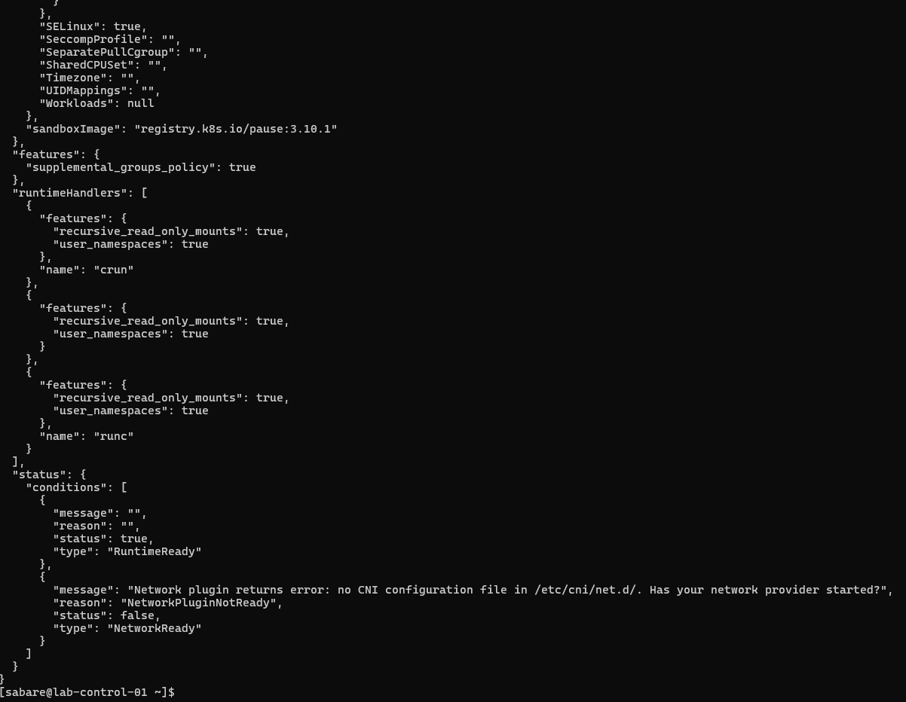
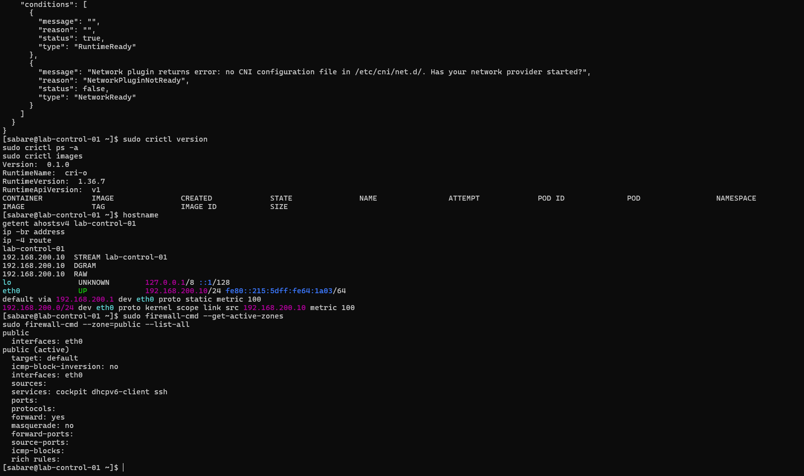
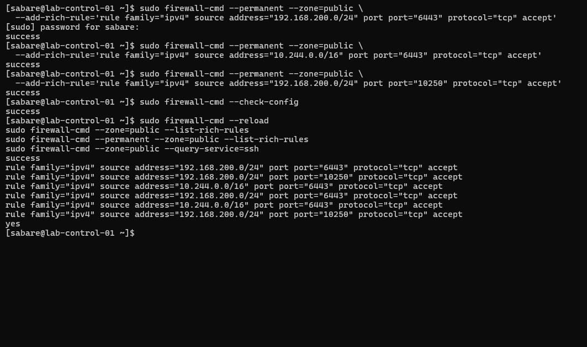
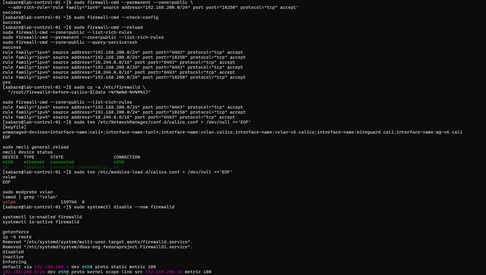
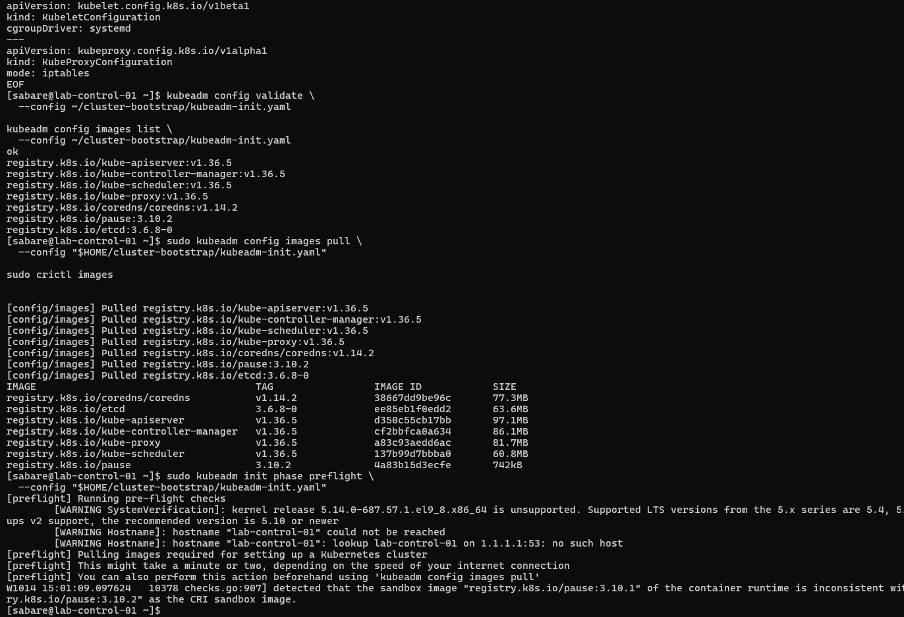
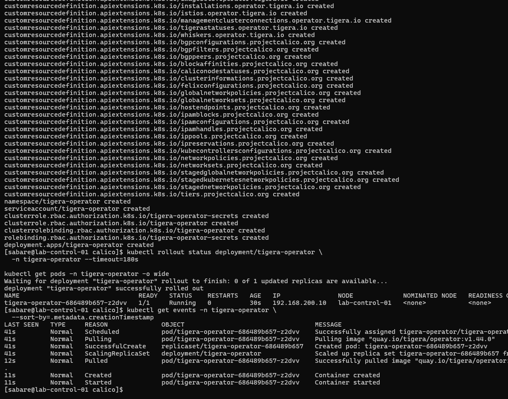

# Control-plane bootstrap and Calico networking

Recorded 2026-10-14. Commands run inside the RHEL VM. Historical creation
commands are not instructions to recreate an existing cluster.

## Verified outcome and remaining work

Kubernetes 1.36.5 initialised successfully on `lab-control-01`. The API server,
etcd, controller manager, scheduler and kube-proxy were Running. The node was
NotReady and both CoreDNS Pods were Pending before the Pod network was installed.
The Calico 3.33.0 operator subsequently reached 1/1 Running with no restarts.

The VXLAN Installation manifest is prepared, **not yet applied or verified**.
Worker joins, workload networking and application deployments remain pending.
The bootstrap-success screenshot contains a join token and is excluded from
public evidence; the non-sensitive results above were transcribed instead.

## Runtime and address verification

```bash
sudo crictl version
sudo crictl info
sudo crictl ps -a
sudo crictl images
hostname
getent ahostsv4 lab-control-01
ip -br address
ip -4 route
```

crictl talks directly to CRI-O through the configured Unix socket. It reported
CRI-O 1.36.7, CRI API v1 and RuntimeReady true. NetworkReady false reported no
CNI configuration; this was expected before installing the network. Empty
container/image lists were historical results before bootstrap.




| Network | Range | Purpose |
| --- | --- | --- |
| Hyper-V VM network | 192.168.200.0/24 | Node addresses; gateway 192.168.200.1 |
| Pod network | 10.244.0.0/16 | Application Pod addresses managed by Calico |
| Service network | 10.96.0.0/12 | Kubernetes virtual Service addresses |

These ranges do not overlap the known local networks. Future VPN routes must
also be checked before connecting the lab to additional networks.

## Firewall and host preparation

Initially, firewalld rich rules allowed TCP 6443 from the VM and Pod networks,
and TCP 10250 from the VM network. Runtime/permanent rules matched and SSH
remained allowed. This intermediate configuration is preserved as history.



The subsequent Calico preparation followed its requirements to disable
firewalld, which can interfere with Calico-managed rules. The configuration was
backed up under `/root/firewalld-before-calico-<timestamp>`. Those earlier rules
are no longer enforced by firewalld. SELinux remains Enforcing. No Calico host
endpoint policies have been configured; Pod policies do not automatically
replace host protection. This is a private Hyper-V lab, not a production
firewall design.

```bash
sudo tee /etc/NetworkManager/conf.d/calico.conf > /dev/null <<'EOF'
[keyfile]
unmanaged-devices=interface-name:cali*;interface-name:tunl*;interface-name:vxlan.calico;interface-name:vxlan-v6.calico;interface-name:wireguard.cali;interface-name:wg-v6.cali
EOF
sudo nmcli general reload
nmcli device status
sudo tee /etc/modules-load.d/calico.conf > /dev/null <<'EOF'
vxlan
EOF
sudo modprobe vxlan
sudo systemctl disable --now firewalld
systemctl is-enabled firewalld
systemctl is-active firewalld
getenforce
ip -4 route
```

NetworkManager must leave Calico interfaces alone. The VXLAN module enables
encapsulated inter-node Pod traffic; its node-to-node transport uses UDP 4789.
Observed results: module loaded, firewalld disabled/inactive, SELinux Enforcing,
eth0 connected and the default route unchanged.



## Bootstrap verification

The guest configuration at `~/cluster-bootstrap/kubeadm-init.yaml` selected
Kubernetes v1.36.5, API endpoint `192.168.200.10:6443`, CRI-O socket
`unix:///var/run/crio/crio.sock`, the networks above, systemd cgroups and
kube-proxy iptables mode.

```bash
kubeadm config validate --config ~/cluster-bootstrap/kubeadm-init.yaml
sudo kubeadm config images pull --config "$HOME/cluster-bootstrap/kubeadm-init.yaml"
sudo crictl images
sudo kubeadm init phase preflight --config "$HOME/cluster-bootstrap/kubeadm-init.yaml"
```

Validation returned ok and images downloaded. Preflight completed with warnings:
the vendor 5.14 kernel was not in the upstream LTS list, hostname DNS lookup
failed, and CRI-O's pause 3.10.1 differed from kubeadm's 3.10.2. Hostname and pause
image corrections were proposed, but separate confirmation of those corrections
was not supplied. Successful bootstrap does not prove every warning was cleared
or establish production support for this combination.



The subsequent command completed successfully; **do not rerun it**:

```bash
sudo kubeadm init --config "$HOME/cluster-bootstrap/kubeadm-init.yaml"
```

The administrator configured kubectl locally and inspected the cluster:

```bash
mkdir -p "$HOME/.kube"
sudo install -o "$(id -u)" -g "$(id -g)" -m 600 \
  /etc/kubernetes/admin.conf "$HOME/.kube/config"
kubectl cluster-info
kubectl get nodes -o wide
kubectl get pods -n kube-system -o wide
```

Keep the generated kubeconfig and join tokens out of Git. At this stage the
control-plane containers were Running; node readiness awaited networking.

## Operator installation

Calico v3.33.0 manifests were downloaded from the pinned upstream tag into
`~/cluster-bootstrap/calico`. The v3 CRDs were created before the operator:

```bash
kubectl create -f v3_projectcalico_org.yaml
kubectl create -f tigera-operator.yaml
kubectl rollout status deployment/tigera-operator -n tigera-operator --timeout=180s
kubectl get pods -n tigera-operator -o wide
kubectl get events -n tigera-operator --sort-by=.metadata.creationTimestamp
```

The rollout succeeded, with 1/1 Running and normal image-pull/start events.
Operator readiness alone does not establish Pod-network readiness.



## Next batch: configure VXLAN (pending execution)

Copy the contents of [the prepared Installation manifest](../infra/kubernetes/calico-installation.yaml)
to `~/cluster-bootstrap/calico/calico-installation.yaml` in the VM.

- `bgp: Disabled` disables BGP route exchange.
- `encapsulation: VXLAN` uses VXLAN for cross-node traffic, including nodes on
  the same subnet; this is not the CrossSubnet setting.
- `cidr` matches the kubeadm Pod subnet. `/26` is an allocation block size,
  not a limit of 64 Pods for the entire cluster.
- `natOutgoing: Enabled` translates outgoing Pod traffic to destinations outside
  Calico IP pools so the external network can return traffic to the node.
- `linuxDataplane: Iptables` retains the selected dataplane and kube-proxy.

Validate against the installed API, then apply only if validation succeeds:

```bash
cd ~/cluster-bootstrap/calico
kubectl apply --dry-run=server -f calico-installation.yaml && \
  kubectl apply -f calico-installation.yaml
kubectl get installation.operator.tigera.io default
kubectl get tigerastatus
kubectl get pods -n calico-system -o wide
```

Allow reconciliation and image downloads, then inspect:

```bash
kubectl wait --for=condition=Ready node/lab-control-01 --timeout=180s
kubectl get nodes -o wide
kubectl get pods -n kube-system -o wide
kubectl get tigerastatus
sudo crictl info
```

A timeout calls for inspecting events and operator status, not rerunning kubeadm
init. Node Ready, RuntimeReady/NetworkReady true and healthy system Pods are
targets, not results already observed. Cross-node connectivity requires workers
and later tests. Optional observability components are deferred.

## References

- [Calico requirements](https://docs.tigera.io/calico/latest/getting-started/kubernetes/requirements)
- [Operator installation](https://docs.tigera.io/calico/latest/getting-started/kubernetes/self-managed-onprem/onpremises)
- [Installation API](https://docs.tigera.io/calico/latest/reference/installation/api)
- [NetworkManager preparation](https://docs.tigera.io/calico/latest/operations/troubleshoot/troubleshooting#configure-networkmanager)
